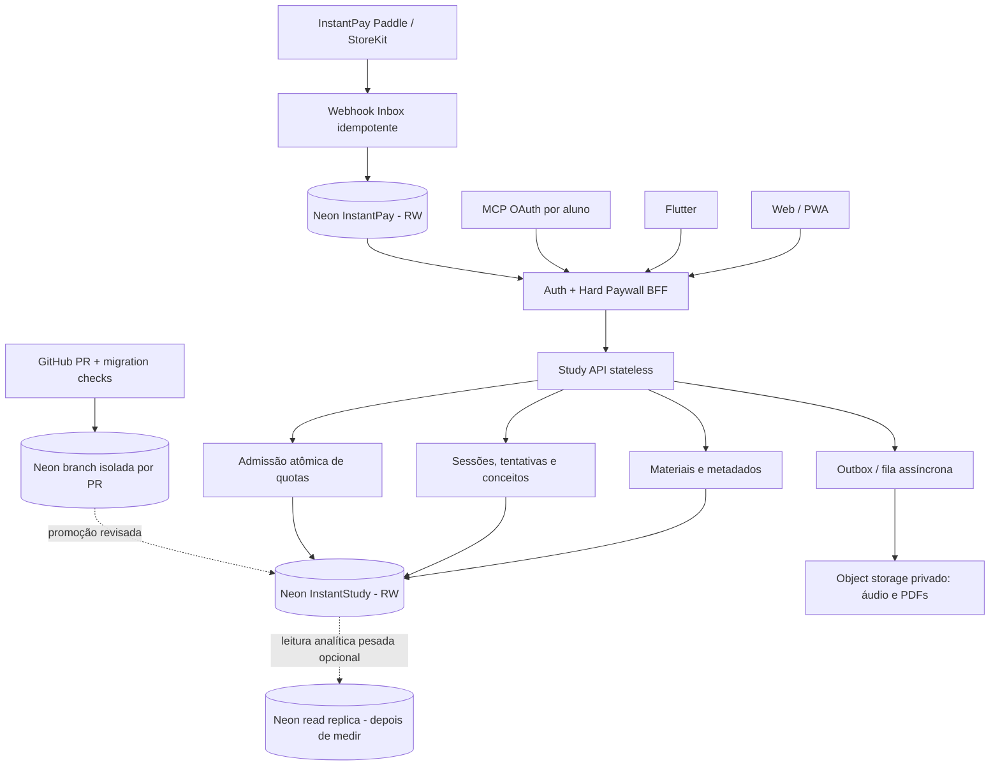

# NEON_SCALABILITY.md — Arquitetura escalável do InstantStudy™

> **Auditoria do esquema e plano de escalabilidade Neon PostgreSQL**  
> Data-base: **12 de outubro de 2026** · Versão: **1.0**  
> Ambiente analisado: código na branch `fix/instantstudy-apple-hig-20261012` (cadeia de PRs #49–#53).  
> **Resultado: arquitetura inicial adequada para desenvolvimento, NÃO CERTIFICADA PARA ESCALA OU PRODUÇÃO.**  
> Escopo desta entrega: **somente GitHub e documentação**. Nenhuma query foi executada no Neon, nem migrações, segredos, deploys, papéis, índices ou custos foram alterados.

## 1. Decisão executiva

**Continuar com Neon PostgreSQL como banco primário**. No InstantStudy, o primeiro gargalo relevante não é falta de CPU: são **concorrência, modelo de dados, migrações e consultas**. Corrigir essas falhas antes de aumentar compute ou comprar réplicas.

Prioridades:

1. **P0 — integridade:** tornar consumo de quota e webhook de assinatura transacionais/idempotentes; separar DDL de runtime; garantir autorização por aluno em cada acesso.
2. **P0 — consulta:** deixar de derivar revisões FSRS a partir dos últimos 100 `session_json`; materializar agenda/indexá-la por `learner_id` e `due_at`.
3. **P1 — modelo:** separar metadados de biblioteca de conteúdo e assets grandes; garantir FKs e ciclo de vida dos arquivos; adicionar índices para buscas reais.
4. **P1 — capacidade:** monitorar `pg_stat_statements`, latência P95, working set e CPU antes de alterar tamanho/autoscaling; aplicar conexão correta por workload.
5. **P1 — recuperação:** migrations versionadas num caminho único, branches Neon por PR e ensaios de restore, rollback e reprocessamento.

**Não implementar sharding ou read replicas antes de medir o gargalo.** Uma única instância PostgreSQL bem indexada pode atender ao MVP com custo menor; dimensionamento só é comprovado por testes com dados representativos.

## 2. Inventário real encontrado no repositório

| Camada | Arquivos | Estado |
|---|---|---|
| Política de armazenamento | `apps/mcp-server/src/databasePolicy.ts` | Exige `DATABASE_URL` em Vercel/produção; memória apenas em desenvolvimento |
| Materiais | `apps/mcp-server/src/materialStore.ts` | Neon HTTP driver, filtro por `learner_id`; lista material completo |
| Sessões e revisão FSRS | `apps/mcp-server/src/studyPersistence.ts` | Sessão inteira em JSONB; revisão calculada percorrendo 100 sessões |
| Progresso de cartões | `apps/mcp-server/src/flashcardProgress.ts` | PK `(learner_id, material_id, card_id)`; sem FK para material |
| Salas e membros | `apps/mcp-server/src/studyRoomStore.ts` | Code UNIQUE, PK composta para membros; leitura de sala + membros separadas |
| Quotas | `apps/mcp-server/src/entitlements.ts`, `aiAssetQuota.ts`, `realtimeQuota.ts` | Quotas IA/voz atômicas; uso mensal Learn/Test com read-modify-write |
| Upload de áudio | `apps/mcp-server/src/largeAudioUpload.ts` | Chunks em Base64 dentro do PostgreSQL, limpeza no tráfego |
| Pagamentos | `apps/pay/api/_db.js`, `webhook.js` | Ledger de evento + entitlements; evento registrado antes da conclusão do processamento |
| Migrações | `database/migrations/{0001,0002,0003}*.sql`, `db/migrations/20261012*.sql` | **Dois diretórios**, com tabelas repetidas; vários serviços executam DDL em runtime |
| Auditoria live | `scripts/verify-neon-schema.mjs` | Verifica poucas tabelas/índices, não todos os módulos e constraints |
| Web/Flutter | `apps/web/api/study.js`, `apps/flutter_app/lib/instantstudy_api.dart` | Acesso por APIs; não distribuir credenciais Neon em clientes |

**Observação de ambientes:** `docs/NEON_ONLY_AUDIT.md` descreve InstantStudy e InstantPay como projetos Neon distintos. Isso é uma **decisão de arquitetura**, não comprovação nova de que as branches, permissões e a produção atuais estejam corretamente configuradas. O relatório `docs/INSTANTSTUDY_RELEASE_READINESS_20261012.md` registra um teste histórico de tabelas em preview; sem consulta live nesta auditoria, não há confirmação do estado atual.

## 3. Matriz de riscos prioritários

| ID | Gravidade | Achado comprovável no código | Consequência provável | Correção alvo |
|---|---|---|---|---|
| DB-P0-01 | **P0** | `EntitlementService.consume()` lê limite, incrementa em memória e chama `saveUsage()`, cujo upsert grava contadores absolutos | Race condition, perda de incrementos, possível ultrapassagem da quota | **Admissão atômica** dentro de transação SQL, com chave da conta e período |
| DB-P0-02 | **P0** | `webhook.js`: `recordEvent` insere `billing_events` antes de atualizar `billing_entitlements` | Se processamento falhar após insert, reentrega é descartada como duplicada | Inbox com estados e reprocessamento seguro; atualizações transacionais e proteção contra evento antigo |
| DB-P0-03 | **P0** | `materialStore`, `studyPersistence`, `flashcardProgress`, quotas e `_db.js` fazem `CREATE TABLE IF NOT EXISTS` durante serviço/chamada | Cold starts mais caros, DDL concorrente, privilégios elevados no runtime, drift | Um único migrador versionado, em CI controlado, sem DDL na aplicação |
| DB-P0-04 | **P0** | As migrações existentes não contêm `ENABLE ROW LEVEL SECURITY`/policies e os registros usam `learner_id` de texto | Isolamento depende da camada de API e papéis; defesa em profundidade insuficiente | Role de runtime sem DDL, política RLS **planejada e testada** com identidade confiável, mais checagem de propriedade |
| DB-P0-05 | **P0** | `studyPersistence.get(sessionId)` filtra somente por UUID; API faz autorização posterior; `save` upserta o JSON completo | Rotas internas futuras podem omitir owner-check; atualizações concorrentes podem sobrescrever estado | Persistência owner-scoped, versionamento otimista e auditoria de todas as rotas |
| DB-P1-01 | P1 | `dueReviews()` e `priorConcepts()` carregam no máximo 100 sessões e percorrem `session_json` em memória | Revisões antigas deixam de entrar na fila; custo cresce com histórico | Tabela por conceito/revisão com índice `(learner_id, due_at)` |
| DB-P1-02 | P1 | `materialStore.list()` seleciona `content` e `assets_json` mesmo para cards de biblioteca | Mais bytes no banco/API, pressão de memória e transferência | Projeção só de metadados, detalhe sob demanda, paginação por cursor |
| DB-P1-03 | P1 | Busca `ILIKE '%texto%'` em `content` e `title`; somente índice de `(learner_id, updated_at)` | Full scan dentro do conjunto do aluno, conforme volume | `tsvector`+GIN / `pg_trgm` se comprovada necessidade; índice por plano de execução |
| DB-P1-04 | P1 | `largeAudioUpload.ts` salva áudio Base64 em `instantstudy_large_audio_parts` | Bloat/WAL/custo de storage, retenção de binário, latência de I/O | Object storage privado para binários, Neon armazena apenas URI/owner/hash/TTL; sem outro banco |
| DB-P1-05 | P1 | Limpeza de uploads antigos é executada no caminho de upload, e não via rotina agendada | Chunks órfãos persistem se ninguém realizar novos uploads | Worker/cron idempotente com métricas e limite por lote |
| DB-P1-06 | P1 | `flashcard_progress` não referencia `materials`; salas mantêm `material_id` sem FK | Órfãos e divergência de propriedade | FKs, regras de exclusão e constraints depois de limpar dados legados |
| DB-P1-07 | P1 | `billing_family_members` faz `COUNT` seguido de `INSERT`, sem serialização clara | Convites simultâneos podem exceder limite de 4 | Lock lógico por titular/transação serializável, testes concorrentes |
| DB-P1-08 | P1 | `verify-neon-schema.mjs` valida apenas sessão, material, progress e alguns índices | Release verde com billing/quotas/revisões faltando | Manifesto único de migrações com versões, checksums e schema diff |
| DB-P2-01 | P2 | Não há evidência nesta inspeção de réplicas, tuning, cache hit rate ou plano pago atual | Não é possível estimar throughput/custo real | Benchmark com carga e métricas reais antes de dimensionar |

**Não foi constatado incidente em produção.** Os riscos são inferidos da lógica das consultas/transações e exigem testes de carga/concor­rência para quantificar impacto. A ausência de RLS não prova vazamento; significa que o controle atual depende de código e privilégios.

## 4. Arquitetura-alvo proposta



**Separação de domínios:** InstantStudy (conteúdo, aprendizagem, revisões, quotas pedagógicas) e InstantPay (assinaturas, eventos, titularidade financeira). Duas contas ou bancos lógicos não significam transações ACID distribuídas; usar API de entitlement de leitura autorizada, event IDs e reconciliação para manter consistência eventual de direitos.

**Dados binários:** manter Neon como único **banco de dados**, mas guardar PDFs/áudios grandes em object storage privado com URLs temporárias, criptografia, owner metadata e limpeza. Banco relacional não precisa armazenar os próprios bytes.

### 4.1 Modelo mínimo recomendado

| Entidade | Chave/escopo | Índices/constraints desejados | Por quê |
|---|---|---|---|
| `learners` (identidades verificadas) | `user_id` imutável | PK, dados pessoais minimizados | Resolver a identidade real antes de aceitar estudo |
| `materials` | `id` UUID + `learner_id` | `(learner_id, updated_at DESC, id DESC)`, FK a learner quando pronto | Biblioteca ordenada e paginação estável |
| `material_assets` | `asset_id`, `material_id` | FK por proprietário, object_key, size, checksum, status | Fontes e áudio sem Base64 no Postgres |
| `study_sessions` | `session_id` UUID + `learner_id` | `(learner_id, updated_at DESC)`, `revision BIGINT` | Reentrância, revogação e concorrência |
| `concept_progress` | `(learner_id, material_id, concept_key)` | `(learner_id, next_review_at)` parcial para itens ativos | FSRS sem varredura de JSON |
| `study_attempts` | `attempt_id` UUID; session/concept/learner | FK, `(learner_id, created_at DESC)` | Trilha imutável de avaliação e AHA auditável |
| `flashcard_progress` | PK atual | FK composta de material+owner; índice para paginação se necessário | Evitar cartões órfãos |
| `usage_counters` | `(learner_id, period)` | PK, constraints >= 0 | Quota atômica |
| `billing_event_inbox` (InstantPay) | `event_id` | UNIQUE, `status`, `attempt_count`, `last_error`, `processed_at` | Retry confiável sem perda de webhook |
| `billing_entitlements` (InstantPay) | identity+subscription+plan | UNIQUE externo, `last_event_at`, source version | Prevenir evento antigo de reativar cancelado |

**Estratégia de migração:** manter temporariamente `session_json` para compatibilidade e extrair para `concept_progress` e `study_attempts` com backfill em lotes; dual-write com reconciliação temporária; mudar leitura após validar contagem/consistência; remover campos antigos só em migração posterior aprovada.

## 5. Correção de concorrência (P0)

### Quota mensal — nunca read-modify-write sem transação

Fluxo atual: `get() → validar limite → incrementar em JS → saveUsage()`. Dois pedidos simultâneos podem ler o mesmo valor e gravá-lo novamente.

**Contrato novo:** uma única operação transacional escolhe o plano autorizado, verifica saldo e incrementa. O chamador recebe **admitido/rejeitado + novo uso**. O contador não pode ser incrementado duas vezes pelo mesmo `idempotency_key` de tentativa.

Exemplo **ilustrativo** para um contador cuja chave e plano já foram validados num contexto de transação; **não aplicar diretamente sem adaptar o schema de produção**:

```sql
-- PROPOSTA: adaptar para o billingPlan/limit autoritativo e idempotency_key.
-- Não emitir este SQL sozinho para um usuário sem identidade verificada.
INSERT INTO instantstudy_usage(learner_id, period, learn_rounds, practice_tests)
VALUES (:trusted_learner_id, :period, 1, 0)
ON CONFLICT (learner_id, period) DO UPDATE
SET learn_rounds = instantstudy_usage.learn_rounds + 1,
    updated_at = now()
WHERE instantstudy_usage.learn_rounds < :validated_plan_limit
RETURNING learn_rounds;
-- Zero linhas = quota esgotada. Também aplicar a condição ao INSERT
-- com uma transação autoritativa e limites válidos; ver caso plano=unlimited.
```

O SQL acima é **pseudocódigo com parâmetros de exemplo**; não representa uma migração pronta. Uma implementação correta precisa decidir limite e idempotência dentro da mesma transação; linha inexistente e limites zero devem ser contemplados, e acesso pago não pode ser decidido pelo cliente.

### Webhooks Paddle / IAP — sem perda de retry

Atualmente `recordEvent()` grava `event_id` antes de `upsertEntitlement`/`updateSubscriptionState`. Se o segundo passo falhar, outro webhook com o mesmo `event_id` recebe `duplicate` e não reexecuta a atualização.

**Contrato obrigatório:** evento verificado recebido → inbox `pending` → claim por worker/transação → atualizar assinatura/entitlement condicionado ao relógio/versão do provedor → marcar `applied` e confirmar; `failed` volta a ser elegível para retry. Duplicata só confirma como processada após `applied`. Idempotência no resultado, não apenas no recebimento.

Testar: falha de DB entre inbox e entitlement, evento repetido, evento antigo após cancelamento, chargeback, disputa, assinatura criada sem email, usuário troca de conta, retries simultâneos.

### Consistência de estudo

- `study_sessions`: `revision` incrementada somente se versão atual confere (`UPDATE ... WHERE revision = :expected RETURNING ...`).
- Cada `study_attempt` tem ID único fornecido/derivado de solicitação autenticada, **constraint UNIQUE para deduplicação** e tentativa imutável.
- Persistir tentativa, estado do conceito, quota e evento de telemetria de forma coerente **por domínio**; para eventos externos, usar outbox; evitar duas operações em bases distintas como se fossem uma transação.
- Pagamento e sessões não compartilham um transaction manager distribuído.

## 6. Consultas e índices que geram ganho antes de trocar plano

### 6.1 Revisão FSRS indexada

A revisão atual recalcula a fila lendo `recentSessions(learnerId, 100)`, perdendo itens mais antigos.

**Leitura proposta:**

```sql
SELECT material_id, concept_key, next_review_at, stability, difficulty
FROM instantstudy_concept_progress
WHERE learner_id = $1
  AND next_review_at <= now()
  AND status = 'active'
ORDER BY next_review_at ASC, concept_key ASC
LIMIT $2;
```

Índice candidato, validar com `EXPLAIN (ANALYZE, BUFFERS)` **em preview com dataset representativo**, sem executar na produção automaticamente:

```sql
CREATE INDEX CONCURRENTLY IF NOT EXISTS concept_progress_due_idx
  ON instantstudy_concept_progress
     (learner_id, next_review_at, concept_key)
  WHERE status = 'active';
```

`CREATE INDEX CONCURRENTLY` **não pode executar dentro de bloco de transação**. O índice só deve ser criado após a tabela proposta existir, fora do processo Web/API, respeitando lock, custos e cenário de rollback.

### 6.2 Biblioteca — payload e paginação

A consulta atual traz `content` e `assets_json` para toda listagem. Separar:

- `GET /materials`: `id, title, source_type, updated_at, card_count, review_count, thumbnail/status`, cursor.
- `GET /materials/:id`: conteúdo integral/JSON só quando abrir o material.
- Índice candidato: `(learner_id, updated_at DESC, id DESC)`; cursor `(updated_at, id)`; `LIMIT <= 50`.
- Busca textual: caso real de uso justifique, avaliar `pg_trgm` para título ou `tsvector`/GIN para conteúdo; não adicionar GIN em texto enorme sem medir índice, escrita e custo de storage.

### 6.3 Hot data, JSONB e anotações

- Preferir colunas normalizadas para filtros e filas; manter JSONB para documento derivado pouco consultado.
- Evitar regravar `session_json` de dezenas de KB a cada resposta, se somente score/agenda mudou.
- Não colocar PDF e áudio Base64 em JSONB ou `TEXT` de tabela quente.
- Restringir `SELECT *`, `ILIKE '%...%'`, `ORDER BY` sem índice e processamento de centenas de sessões no processo Node.

## 7. Neon: conexões, pooling, autoscaling e réplicas

### 7.1 Conexão correta para cada tipo de trabalho

- **Web serverless/API simples:** `@neondatabase/serverless` `neon(DATABASE_URL)` executa queries HTTP stateless, o que é apropriado para operações curtas. O driver já está no repositório.
- **Transações interativas e workers persistentes:** usar driver/cliente compatível com o tipo de transação e URL do Neon; escolher `Pool`/WebSocket quando for necessário manter contexto de sessão/transação, respeitando a documentação atual da biblioteca.
- **PgBouncer transaction pooling (conexão `-pooler`):** recomendado para clientes Postgres TCP/WebSocket e altos picos de conexões quando for compatível; não assumir que acrescentar `-pooler` a um fluxo HTTP o tornará mais rápido.
- **Migrations e DDL:** usar papel dedicado e ligação direta sob execução isolada, conforme exigências da ferramenta; evitar DDL com role da aplicação e evitar depender de estado de sessão com transaction pooler.
- **Segurança:** `DATABASE_URL` somente no servidor/CI secreto; `sslmode=require`/parâmetros TLS conforme string gerada pelo Neon; rotacionar por projeto, papel e ambiente.

### 7.2 Compute

Recomendação inicial: configurar limite mínimo/máximo de autoscaling **após** medir throughput, working set, query P95, cold start e custo por estudo. Neon's escala de compute depende dos limites do plano/região.

- Produção com SLO de baixa latência: avaliar desabilitar **scale to zero** para evitar retomada, sujeito a custo.
- Desenvolvimento e previews: permitir **scale to zero** e limites menores; branches sem uso devem expirar.
- Um compute maior não resolve lock/contention de quota, scans JSONB ou payload excessivo.
- Dimensionar mínimo suficiente para working set/cache e máximo para picos mensurados.

### 7.3 Réplica de leitura

Considerar read replica quando consultas pesadas de análises, relatórios, conteúdos públicos e listagem dominarem CPU/IO da primária. Não deslocar para réplica verificações críticas de entitlement, confirmação de escrita, quota e read-after-write de progresso até ter um contrato explícito de consistência e teste de operação.

Neon separa compute e storage: réplicas de leitura usam compute separado com storage compartilhado, não uma cópia manual da base; ainda geram consumo de compute. **Não são obrigatórias na fase 1.**

### 7.4 Branch por Pull Request

- `production` somente para release validada; `staging` e `preview/pr-<id>` em branches Neon distintas.
- Preferir branch **schema-only** ou dados sintéticos/anônimos para não replicar material privado de aluno em CI.
- Rodar migrations + `verify-neon-schema` estendido + EXPLAIN/carga em branch temporária.
- Comparar schema diff, revisar impacto e custo; promover migrations separadas do deploy, com rollback/backfill.
- Eliminar branch de preview após encerrar PR, com controle de custo e auditoria.

**Nota importante:** criar branch PostgreSQL no Neon e criar branch GitHub são operações distintas. Nada neste documento cria branch Neon automaticamente.

## 8. Segurança de dados e RLS

A maioria das consultas seleciona `learner_id`; isso é positivo, mas **não substitui RLS nem roles mínimos**. Um ID de aluno enviado pelo cliente não deve virar contexto de DB sem verificação do token/sessão por serviço confiável.

**Fases de RLS sugeridas:**

1. Mapear papéis atuais de execução; verificar se cliente usa owner/admin (papel proprietário pode contornar políticas) e quais tabelas realmente recebem queries.
2. Criar `runtime_study` e `runtime_billing` separados, sem DDL/owner e sem `BYPASSRLS`; papéis de migração apartados. Evitar que web/app abra acesso a DB.
3. Definir `USING`/**`WITH CHECK`** para SELECT/INSERT/UPDATE/DELETE por tabela e owner, com identidade **verificada** vinculada à transação ou JWT validado no Data API. `set_config('app.user_id',...)` em role compartilhado não é segurança por si só se o cliente puder manipular a sessão.
4. Testar usuário A lendo/escrevendo linhas B em cada endpoint, jobs privilegiados, conta expirada e funções de serviço; **não habilitar RLS globalmente sem a role/policy correta** (risco de downtime).
5. Avaliar Neon Data API com RLS somente se sua arquitetura/auth exigir acesso diretamente mediado por API. O uso atual é BFF/servidor com SQL, portanto manter API confiável pode ser mais simples.

Permissões de pagamento e identidade devem ser mais restritivas que permissões de estudo. Não misturar ledger financeiro com pesquisa genérica. Persistência de `material_id` e `learner_id` deve ser mutuamente verificável por FK/constraint ou checagem transacional.

## 9. Migrações versionadas (sem DDL em request)

A estrutura atual usa:
- `database/migrations/`: `0001_core`, `0002_offer_layer`, `0003_agents_quotas`;
- `db/migrations/`: `20261012_core_study`, `20261012_flashcard_progress`;
- diversos `init()`, `ensureSchema()`, `ensureTables()` com `CREATE TABLE IF NOT EXISTS`.

**Plano:** escolher um **único** caminho, por exemplo `database/migrations/`, adicionar tabela `schema_migrations(version, checksum, applied_at, execution_time_ms)` e migração sequencial revisada. `CREATE TABLE IF NOT EXISTS` mascara divergências de definição; o release precisa comparar constraints, índices, colunas e types.

Checklist de uma migração:

1. Auditoria de esquema live **read-only**, exportar schema/versão sem tokens e sem dados pessoais.
2. Branch Neon temporária com dados sintéticos; aplicar baseline com migrações já existentes sem duplicar tabelas.
3. Versão expand: adicionar tabelas/colunas/índices com `CONCURRENTLY` quando apropriado, constraints inicialmente `NOT VALID` apenas onde suportado.
4. Backfill em lotes idempotentes; medir lock e WAL; testar retry, duplicata e rollback.
5. Deploy de aplicação compatível com schemas antigo e novo; monitorar, ativar dual-write se necessário.
6. Trocar leituras, validar dados, `VALIDATE CONSTRAINT` e depois remover colunas antigas em outra release aprovada.
7. `audit:neon-live` inspeciona **todo** inventário crítico, com evidência de PR, SHA e migration version; CI falha se mismatch.

Nunca permitir que cold start de várias funções tente migrar a produção simultaneamente.

## 10. Operação, performance e custo

### Indicadores operacionais

| Medida | Definição/limiar inicial proposto | Alerta |
|---|---|---|
| Latência API de lista/due | P95 < 250 ms **no servidor em preview sob carga-alvo**, a recalibrar | > 2× baseline por 15 min |
| Latência transação quota | P95 < 100 ms (DB, excluindo rede cliente), medido | Falhas/retries anormais |
| Erros 5xx do DB | < 0,5% de requisições válidas em teste; meta de produto a validar | Aumento sustentado |
| Conexões ativas/pool | Abaixo do limite do compute/pooler com margem | 80% do teto real |
| CPU e cache | Métricas Neon de compute, working set e Local File Cache | Hot set excede cache recorrente |
| Locks/conflitos | Sem deadlocks sistemáticos; `pg_stat_activity`/wait events | Bloqueios longos em quota/billing |
| WAL/armazenamento | Volume diário, growth index/TOAST, chunks de upload, storage unique branch | Crescimento inesperado |
| Contadores e consistência | Quota jamais excede limite sob concorrência; 0 perdas de webhook em fault injection | Qualquer violação |
| RPO/RTO | Definir **antes da produção**, com restore cronometrado | Falha no ensaio |
| Margem | Custo Neon + object storage + LLM/OCR/voz por assinante ativo | Margem abaixo da meta financeira |

Os números P95 acima são **metas propostas**, não medições reais nem compromisso de SLA Neon. End-to-end também depende de latência da IA, rede, autenticação e tamanho de arquivo.

### Carga e testes

Criar fixtures sintéticas; testes por cenário (não somente um número de usuários):
- **10k / 100k / 1M** materiais *sintéticos* conforme orçamento de teste (volumetria incremental); tamanho realista de JSONB e texto.
- **50, 250 e 1.000 requisições concorrentes** de carga progressiva **apenas em preview autorizado**, respeitando quotas/limites do plano. Não assumir que equivalem a 50/250/1000 alunos simultâneos.
- 1.000 tentativas concorrentes de quota: jamais mais admissões do que permitido, idem para familiares.
- Evento Paddle duplicado, fora de ordem, falha entre insert/atualização e replay: toda assinatura converge ao estado correto.
- Alunos A/B/C: nenhuma leitura/alteração entre contas, incluindo salas, cartões, áudio, revisões e sessões.
- Upload chunk interrompido, expirado e repetido; cleanup sem bloat acumulado.
- 10k conceitos vencendo no mesmo minuto: fila paginada correta, sem full scan.
- Reinicialização da API e restore isolado: os dados permanecem consistentes.

Ferramentas candidatas: `k6` para tráfego de API, `pgbench` para workload SQL controlado, `pg_stat_statements` e `EXPLAIN (ANALYZE, BUFFERS)` em preview. Não executar cargas na branch de produção por padrão.

### Perguntas de custo a responder com Neon real

- Região e plano de cada projeto? Mínimo/máximo CU da branch e autosuspend? Storage ativo + histórico? Saída de rede? Branches de preview abandonadas?
- Quantos materiais ativos por aluno, tamanho médio de JSONB/texto, sessões por semana e atualizações FSRS?
- Qual % do gasto total é Neon vs LLM vs áudio/OCR vs Paddle/IAP?
- Qual limite de gasto e alerta mensal? Quem aprova aumento de compute?

Sem telemetria dessas variáveis **não estimar custo fixo nem afirmar suporte para 100 mil/1 milhão de alunos**. Um plano comercial do Neon não deve ser escolhido por número imaginado de usuários.

## 11. Roadmap de implementação e aceites

| Fase | Entrega | Evidência para aprovar |
|---|---|---|
| **F0** (P0) | Inventariar produção read-only, alinhar 2 diretórios de migrations, criar versionamento e preflight | DDL runtime desligado em release candidate; schema diff e CI reproduzíveis |
| **F1** (P0) | Consumo de quotas transacional/idempotente; webhook inbox + retry ordenado; ownership e roles seguros | Concorrência 1.000 operações sem overuse; webhook retry passa após falha injetada; A/B isolados |
| **F2** (P1) | `concept_progress` + índice due, `study_attempts`, migração expand/backfill | Due queue cobre histórico >100 sessões; resultados preservados após rollback e restart |
| **F3** (P1) | Biblioteca metadata-only com keyset, busca indexada onde necessário, object storage de binários | P95 e I/O diminuem com dataset de prova; links privados expiram; cleanup roda |
| **F4** (P1) | Observabilidade, sizing e autoscaling, restore drill, branches por PR; réplica se necessário | SLO medido, RPO/RTO, custos e forecast verificados por 7–14 dias |
| **Release** | Integração de Web/API/Pay e aprovação independente | `audit:release` (48 requisitos) + gates financeiros, segurança, dados e iOS — sem exceções silenciosas |

**Condição de não liberação:** sem verificação live de schema/migrações, sem teste de replay de pagamento e sem correção atômica de quotas, não certificar banco “100% escalável”. O hard paywall depende da consistência do estado financeiro.

## 12. Referências oficiais (Neon e PostgreSQL)

Fontes consultadas em **12/10/2026**; revalidar limites de plano, features e docs no momento da implantação.

1. [Neon — Manage computes / autoscaling e read replicas](https://neon.com/docs/manage/endpoints)
2. [Neon — Connection pooling e PgBouncer](https://neon.com/docs/connect/connection-pooling)
3. [Neon — Serverless driver](https://neon.com/docs/serverless/serverless-driver)
4. [Neon — Branches, preview e schema-only](https://neon.com/docs/get-started-with-neon/workflow-primer)
5. [Neon — PostgreSQL query troubleshooting / pg_stat_statements](https://neon.com/blog/postgres-support-recap-investigating-postgres-query-performance)
6. [Neon — Practical guide to branching](https://neon.com/blog/practical-guide-to-database-branching)
7. [Neon — Point-in-time restore](https://neon.com/blog/announcing-point-in-time-restore)
8. [Neon — Data API and RLS background](https://neon.com/blog/introducing-neon-authorize)
9. [PostgreSQL — Indexes](https://www.postgresql.org/docs/current/indexes.html)
10. [PostgreSQL — Row Security Policies](https://www.postgresql.org/docs/current/ddl-rowsecurity.html)
11. [PostgreSQL — Explicit Locking](https://www.postgresql.org/docs/current/explicit-locking.html)
12. [PostgreSQL — EXPLAIN](https://www.postgresql.org/docs/current/sql-explain.html)

## 13. Relação com os demais contratos

- [engenharia reversa.md](engenharia%20reversa.md): oferta Quizlet e 48 gates de paridade.
- [AHA.md](AHA.md): ativação medida de aluno.
- [APPLE_DESIGN.md](APPLE_DESIGN.md): experiência e submissão iOS.
- [APPLE_DESIGN_IMPLEMENTATION.md](APPLE_DESIGN_IMPLEMENTATION.md): implementação parcial de acessibilidade e fail-closed Flutter.
- [docs/NEON_ONLY_AUDIT.md](docs/NEON_ONLY_AUDIT.md): decisão Neon-only; **pode refletir um estado histórico**.
- [docs/INSTANTSTUDY_RELEASE_READINESS_20261012.md](docs/INSTANTSTUDY_RELEASE_READINESS_20261012.md): release ainda bloqueado.
- [docs/quizlet-parity.manifest.json](docs/quizlet-parity.manifest.json): manifesto de funcionalidades, separado desta auditoria de escala.

**Decisão formal:** Neon PostgreSQL continua como banco principal. O novo alvo é um **PostgreSQL transacional, multiusuário, versionado e observável**, não apenas “aumentar o tamanho do servidor”. Esta documentação não instalou, testou ou alterou nenhum recurso no Neon.
